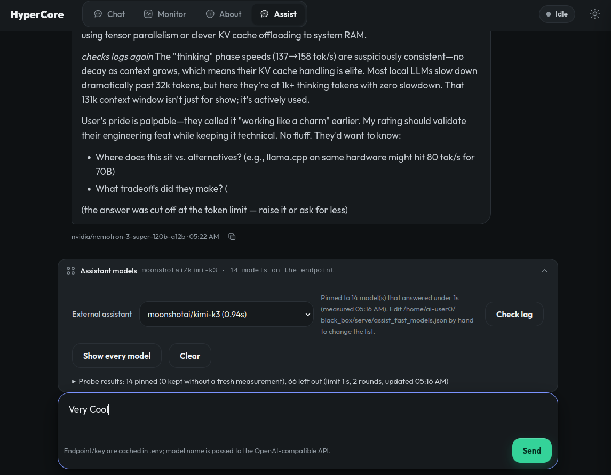

# HyperCore-CCP

**Cuda, CPP, Python.** Big GGUF models on low-spec consumer hardware.

HyperCore runs a 30 B-class MoE model on a single 12–24 GB consumer GPU by keeping the
hot path on the card and the cold path in system RAM, and serving it as an OpenAI- and
Anthropic-compatible API on `http://127.0.0.1:8081`.

Engine version **0.1.40** · CUDA, HIP (AMD), SYCL (Intel Arc) and CPU backends · MIT licensed.

---

## Install

```sh
./install.sh                 # build the engine and run every boundary gate
./setup.sh                   # detect the GPU, pick a model size, start the server
```

`./install.sh` is the build and the gates; `./setup.sh` is the one that asks about your
card, downloads a model and opens the page. Later runs of `./setup.sh`, or the
`run-<model>.sh` it writes, start the model directly.

Step by step, on Windows and Linux, for NVIDIA, AMD and Intel cards:
[docs/INSTALL.md](docs/INSTALL.md). If an AI coding assistant is doing the install for
you, hand it [docs/AI_SETUP.md](docs/AI_SETUP.md).

## How it works

| Technique | What it buys you | Detail |
|---|---|---|
| Expert cache on the GPU | MoE experts stay resident, so decode rarely leaves the card | [HOW_IT_WORKS.md](docs/HOW_IT_WORKS.md) |
| Layer split across GPUs | Two or three cards run contiguous layer ranges, each with its own expert cache | [MULTI_GPU.md](docs/MULTI_GPU.md) |
| MTP / speculative decode | A draft layer proposes, the model verifies | [DETAILS.md](docs/DETAILS.md#speed-measured) |
| KV prefetch and batching | Overlaps the CPU pool with the GPU launch | [KV_PREFETCH.md](docs/KV_PREFETCH.md), [BATCHING.md](docs/BATCHING.md) |
| Prompt- and message-boundary caching | Repeated turns reuse prefill instead of recomputing it | [PROMPT_CACHE_TAIL.md](docs/PROMPT_CACHE_TAIL.md), [MESSAGE_BOUNDARY_CACHE.md](docs/MESSAGE_BOUNDARY_CACHE.md) |
| Disjoint expert cache, exchange rotation | Secondary GPUs and the CPU pool share expert work without contending | [DISJOINT_EXPERT_CACHE.md](docs/DISJOINT_EXPERT_CACHE.md), [EXCHANGE_ROTATION.md](docs/EXCHANGE_ROTATION.md) |

Measured numbers for your card: [docs/DETAILS.md](docs/DETAILS.md#speed-measured). Older
and experimental hardware: [docs/OLDER_GPUS.md](docs/OLDER_GPUS.md).

## The web app: chat, monitor, and a free frontier-model Assist page



The server serves its own front end: open the page the run script opens (the same port as
the API), and `#monitor` for the dashboard. There is no separate app and nothing from a
CDN — `serve/web/` is one page, its styles, an inline SVG sprite and the Outfit font
(OFL), all same-origin.

- **Chat** — streaming answers, the model's thinking shown as it is produced, tool calls
  from the MCP servers you have switched on, and an agent-profile dropdown. The profiles
  come from `prompt.json` beside the server or `prompts/prompt.json` (the one this repo
  ships): adding a profile to that file adds a menu entry with nothing to change in the
  page or the code. `{{current_date}}`, `{{current_year}}` and `{{current_month}}` are
  filled from the server clock, so a profile never hard-codes a year that goes stale. The `system_prompt`
  in that file also names the two resources the model is told to use: the accumulated development history
  under `data/history/` (built by `tools/build_history.py` from the chat transcripts in
  `~/black_box_chats/` and, as a second pass, the older `~/Strata_chats/`; one file per
  topic; live keys, addresses and handles are scrubbed
  on the way out, so the tree is safe to commit)
  and the Assist tools that reach an external model. `GET /prompts` returns it as markdown, and the page
  sends it as the first system turn of every chat.
- **Monitor** — context fill, experts in VRAM, system RAM, GPU temperature, the recent
  requests (prompt, reused, output, tok/s, VRAM hit rate, duration), the conversation
  cache, the MCP switches and the external-assistant log.
- **Assist** — a second chat that answers through an OpenAI-compatible NVIDIA endpoint,
  so a frontier model can be used alongside the local one. The endpoint is free to call,
  but it does need a key: put `ENDPOINT` and `API_KEY` in a `.env` beside the project.
  The model list is the set of models on that endpoint that answered a lag probe inside
  one second; "Show every model" lists the rest, and "Check lag" re-times them.
- **Shut Down** — the red button at the right end of the banner. It asks the server to
  stop, and the server then closes every process it started: the HTTP listener, the model
  engine (asked to free its memory before it is terminated), the image encoder and the
  MCP servers. It is two clicks so a stray click cannot end a model mid-request, and it
  runs the same code path as Ctrl+C and SIGTERM, in plain Python, so it behaves the same
  on Windows and Linux.

What the front end reads, and what changed with it:

- **The request table is populated.** The worker's terminal frame now carries the
  expert-tier accounting the engine already computes — prompt tokens read, cache hits
  and lookups, PCIe offloads, RAM and file blobs — and the caps reply carries the VRAM
  tier (slots in use, slots sized for, cache MiB, free VRAM, how the host-side experts
  are held, prompt chunk). A field the engine did not measure is sent as `0xFFFFFFFF`,
  so a dashboard never shows a measured `0` for something that was simply not measured.
  A worker built against the older 40-byte summary is still read: its timings come
  through and its expert columns show as absent.
- **Prefill is the engine's own rate** — prompt tokens read over the time it took to read
  them — and the card says which request the number came from instead of implying it is
  live.
- **A long prompt is not called stalled.** The stream's silence wall is the supervisor's
  own (`"engine_silence_s"`, 300 s by default; `0` waits as long as the request needs),
  measured from the last frame. The 30 s the worker is given to answer a submit is not
  borrowed for the stream, so a six-figure prompt that takes 31 s to read is not cut off
  mid-prefill.
- **The page carries the key its own server requires**, so an install set up with a
  default key works without typing it into Settings. A key typed in Settings still wins,
  and is kept in that browser only.
- **Turn-tail check** (`--turn-tail-check`, or `"turn_tail_check": true` in the model's
  config — on by default for anything `setup` writes): when a turn would end, the server
  appends one short question asking the model to check its answer against the request. A
  bare confirmation ends the turn; a "no", or the model going on with the work, keeps it
  open, up to `"turn_tail_checks"` times. The question and the confirmation are never
  shown to the client, and every round's tokens are counted in the request's usage.

## The black-box boundary

Everything outside the engine talks through one C header,
`include/hypercore/hypercore_api.h`. The engine is a separate worker process; the
Python side frames messages over IPC.

```
serve/  ── C API ──>  libhypercore_api.so  ──>  hypercore-worker
```

Two gates are **blocking build targets** — the build fails if either is violated:

```sh
python3 tools/check_abi_alignment.py     # header, worker and Python mirrors agree
python3 tools/glibc_floor.py build/libhypercore_api.so
```

The ABI is pinned: `hypercore_request_config_t` 28 bytes (`struct_size@0, temperature@4,
top_p@8, top_k@12, max_new_tokens@16, pcie_frac@20, spec_min_p@24`), `hypercore_caps_t`
56 bytes (the 28-byte contract plus the expert tier), `hypercore_request_summary_t` 68
bytes (the 40-byte prefix plus the per-request expert accounting). Every struct carries
`struct_size` at offset 0: a reader takes the prefix it knows and discards the tail, so
an appended field never breaks an older embedder - a removed one would.

## Technical accomplishments

**Engine**
- 304 C/C++/header files across `src/` and `include/`, with CUDA, HIP and SYCL backends
  chosen at configure time (`-DHYPERCORE_ENABLE_CUDA|HIP|SYCL`).
- Backend-neutral public API: no CUDA, HIP or SYCL type crosses the boundary.
- 47 C/C++/CUDA test files in `tests/` and `bench/`, including the boundary tests that
  link against the built library.

**Interface**
- OpenAI- and Anthropic-compatible HTTP API with streaming, cancellation, and a worker
  supervisor with slot admission and shed-at-gate backpressure.
- A front end served by the server itself (`serve/web`, ~2,900 lines of HTML/CSS/JS):
  chat, a Monitor that reads the engine's own request summary, agent profiles, MCP
  switches. Same origin, no CDN, self-hosted font.
- 8 MCP servers exposing 50 tools (browser, contracts, docs, home, hub, scrape,
  terminal, web), each contract-checked against the handler that implements it.

**Testing**
- 98 Python test modules and 47 C/C++/CUDA test files.
- One command exercises the whole tool surface and reports coverage:

```sh
python3 serve/mcp/tests/run_all.py
# TOTAL  50 tools  235 cases  235 pass  0 fail  0 error  0 skip   OK
# every advertised tool has at least one case
```

**Reproducibility**
- CI (`.github/workflows/boundary.yml`) runs contract-lock → supervisor tests →
  integration guard → model guard (conditional on `pack/full`) → cross-toolchain.
- The glibc floor of the shipped artifact is 2.38, under the 2.39 contract line, so the
  binary runs on older distributions without a rebuild.

**Documentation**
- 28 pages in `docs/`, every internal link verified, plus the design paper
  ([docs/paper/HyperCore-Paper.pdf](docs/paper/HyperCore-Paper.pdf)) and raw benchmark
  data ([docs/benchmarks/](docs/benchmarks/)).

## Repository layout

| Path | Contents |
|---|---|
| `include/hypercore/` | The public C contract |
| `src/` | artifact, core, kernels, ngram, plan, platform, prefill, program, spec |
| `sycl/` | SYCL kernels and includes for Intel Arc |
| `serve/` | HTTP server, supervisor, MCP servers, web front end |
| `tools/` | Validation gates: ABI alignment, glibc floor, benchmarks |
| `tests/`, `bench/` | Engine tests and frozen benchmark evidence |
| `docs/` | User and technical documentation |
| `cmake/`, `CMakeLists.txt` | Build, including the HIP backend |
| `data/` | Draft vocabularies and expert profiles the engine needs |

Generated output is not in the repository: `build*/`, `engine/`, `dist/`, `.venv/`,
model packs, logs, and agent session state. Rebuild with:

```sh
cmake -B build -DHYPERCORE_ENABLE_CUDA=OFF && cmake --build build -j4
```

## History

This repository's history begins here. The prior history of the project (1,182 commits,
42 release tags) is archived in the working tree as `project_history_2026-10-10.txt` and
`project_history_2026-10-10.git.bundle`, both gitignored.

Something went wrong? [docs/TROUBLESHOOTING.md](docs/TROUBLESHOOTING.md).
